**Web Developer & Android Developer**

Membangun aplikasi web modern yang skalabel serta aplikasi mobile Android native yang bersih, fungsional, dan berfokus pada pengalaman pengguna.

---

### Tentang Saya

| Fokus | Detail |
| :--- | :--- |
| **Peran** | Web Developer & Native Android Developer |
| **Fokus Pengembangan** | Full-Stack Web Applications, SaaS Platforms, & Mobile Apps |
| **Saat Ini** | Mengembangkan produk digital, sistem manajemen berbasis web, dan aplikasi Android |

---

### Tech Stack

| Kategori | Logo Teknologi |
| :--- | :--- |
| **Web Frontend** |  |
| **Web Backend** |  |
| **Android Mobile** |  |
| **Database & Tools** |  |

---

### Aktivitas & Statistik Commit

| Ringkasan Kontribusi | Bahasa Pemrograman |
| :---: | :---: |
|  |  |

<picture>
  <source media="(prefers-color-scheme: dark)" srcset="https://raw.githubusercontent.com/dafaardnto1/dafaardnto1/output/pacman-contribution-graph-dark.svg">
  <source media="(prefers-color-scheme: light)" srcset="https://raw.githubusercontent.com/dafaardnto1/dafaardnto1/output/pacman-contribution-graph.svg">
  
</picture>

---

### Kontak

| Platform | Tautan |
| :--- | :--- |
| **WhatsApp / Telepon** | [0855-9866-113](https://wa.me/628559866113) |
| **Email** | [dafaardianto466@gmail.com](mailto:dafaardianto466@gmail.com) |
| **GitHub** | [github.com/dafaardnto1](https://github.com/dafaardnto1) |
| **Instagram** | [@dafaardnto1](https://instagram.com/dafaardnto1) |
